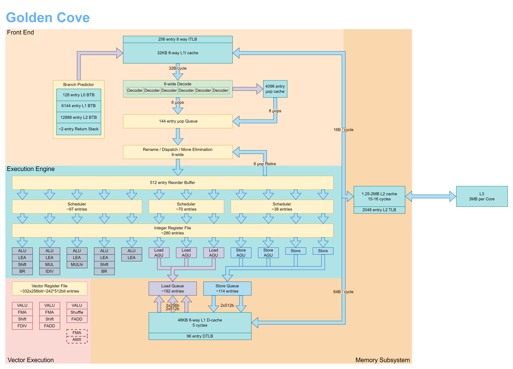
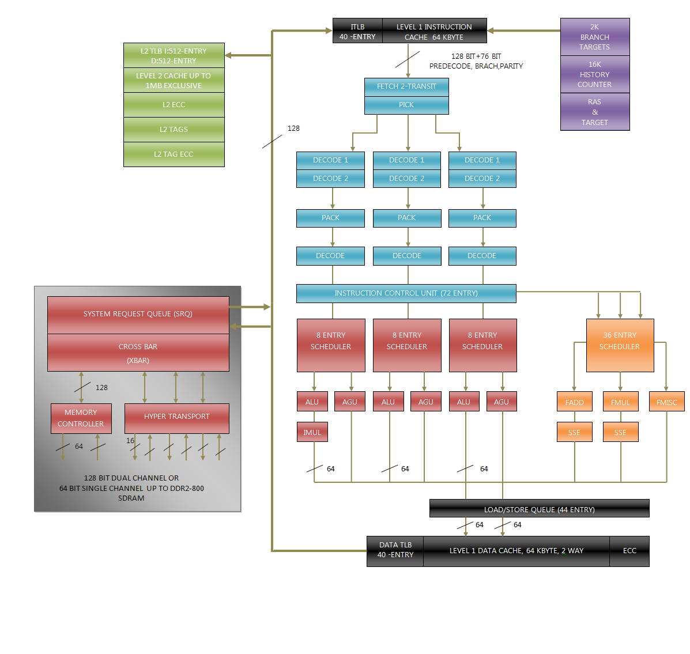

# LEA in x86

I'm sure you have all seen the `lea` instruction when looking at an
x86 assembly. Here is a brief recap of what it does:

## Addition

Lets perform a simple integer addition:

```c
unsigned add(unsigned x) {
    return x + 10;
}
```

Simple, easy. With -O0 (no optimizations), we get the following x86 assembly:
```asm
mov     DWORD PTR [rbp-4], edi // push the first argument x to stack
        mov     eax, DWORD PTR [rbp-4]
        add     eax, 10
```

Cool, it does what we asked for. Lets turn on some optimizations, -O1:
```asm
lea     eax, [rdi+10]
```

Where did the `add` go? It is replaced by the `lea` instruction.

This instruction is called "load effective address", so presumably one of its operands
should be a memory address. In this case, the memory address provided is `rdi + 10`. The `lea`
instruction performs the add and then fetches the data in the memory from that address, and
loads it to `eax`.

The effective address is calculated as:

$$
\text{Effective Address} = \text{Base} + (\text{Index} \times \text{Scale}) + \text{Displacement}
$$
where $\text{Scale}$ is a power of two and is typically $\in \{1,2,4,8\}$

So far so good?

Why does the compiler emit the `lea` instead of `add` when the slightest of optimizations are turned on though?

One of the reasons is that `add` only takes 2 operands in x86, using the first operand as both the source 
and the destination. 

If we simply want to let `eax = rdi + 10`, we can't do this in a single `add` instruction:

```asm
add rdi 10 // rdi = rdi + 10
mov eax rdi // eax = rdi
```

With `lea`, we can effectively (pun intended) do that calculation as the part of an operand, as the 
contents of the given memory location are not loaded, only the effectie address is computed and placed
into the destination register. Whereas, the `add` instruction has to actually go and load the data in the
passed memory location for the memory operand.

Therefore, we can perform an add in a single `lea` instruction compared to the 2 instruction that uses the
regular `add` instruction, which is a small optimization.

## Is this all?

No! There is another important difference between these 2 instructions:
- `add` sets CPU flags (e.g. ZF, SF, PF etc.)
- `lea` doesn't set any flags for its computation!

This means that the `lea` instruction could be used in between some instructions that use the ALU thus set
CPU flags, without modifying any CPU flags that could later be used for conditional operations.

## Adders

Well, we can have different `lea` "types" as well, depending on which operations we do to calculate the
effective address.

It is easy to add 2 integers in hardware, we just reqquire a standard 2 input adder. Therefore,
`lea eax, [rdi + 10]` is relatively easy. In fact, all of these patterns can be done with a 2 input adder:
- `[Base + Index]` e.g. `lea edx, [rdi + rsi]`
- `[Base + Displacement]` e.g. `lea edx, [rdi + 10]`
- `[Base + Index * Scale]` e.g. `lea edx, [rdi + rdi * 2]`

The scale can easily be done before the ALU with a pre-shifter, as the scale can only be 1, 2, 4, 8.

Things gets complicated when we use the full effective address calculation scheme that uses 3 additions:
- `[Base + Index + Displacement]` e.g. `lea edx, [rdi + rsi + 4]`
- `[Base + Index * Scale + Displacement]` e.g. `lea edx, [rdi + rsi * 2 + 4]`

In these cases, adding 3 numbers simultaneously reqquires a 3 input addres, specifically a 3 to 2 Carry Save Adder (CSA),
followed by a Carry Propagate Adder (CPA), along with a shifter for the `Index`. This is a complex operation, and 
only certain ALU ports can execute these types of complex operations. One other option is to of course decode the
3 addition into 2 micro instructions to carry out the addition which means the execution will be done in 2 cycles.

## Architecture

How is the effective address of the `lea` calculated though? 

There might be a couple of options in an architetural point of view here:
- We might very well use the standard ALU to calculate the effective address
- We might utilize the Address Generation Unit (AGU) that is used for address calculation for the `mov` insructions

### Intel Golden Cove

Let's look at the Intel Golden Cove microarchitecture to see how things are laid out for us:



As can be seen from the microarchitecture diagram, there are multiple `Load AGU` and `Store AGU` units in the Execution Engine.
Having multiple AGU units allow for instruction parallelism, typically performing address calculations of different `mov`
instructions in parallel.

What is interesting here is that the result of AGUs are connected to Load/Store Queues, which are in turn associated
with the D-TLB/L1D tag arrays. If we were to use this path for just address calculation, we would have to route the result
using the 64-bit result bus from the memory ports back accross the die into the register file, and we would have to bypass
the ALU which would add even more routing congestion for zero architectural benefit.

### Intel Atom

In the Intel Atom pipeline (which is a microprocessor designed for low power consumption, energy efficiency and compact scale), 
the `lea` instruction uses the AGU rather than the ALU. This causes a latency of 4 clock cycles when dependent on a pointer register 
or index register, due to the distance between AGU and ALU. In this architecture, it may be faster to use addition and shift 
instructions compared to `lea` in most usecases.

### AMD K8 & K10

One of the most notable differences between the AMD microarchitecture and Intel microarchitecture is that AMD microarchitecture 
contains 3 paralell pipelines, and the instructions are distributed between the 3 pipelines right after the fetch stage:



It is possible for instructions to jump through different pipelines, but in simple cases each instruction stay in their pipeline
all the way to the retirement.

Anyways, in AMD K8 & K10 architectures, each of the 3 integer pipelines has 1 ALU and 1 AGU units. For the `lea` instruction, the three
AGUs are used for the complex versions of it. This way, it is actually possible to do 2 memory operations and 1 `lea` in the same clock
cycle, whereas it is not possible to do 3 memory operations in 1 cycle because the data cache only takes in 2 ports.

In the K10 microprocessor:
- if a `lea` contains 2 operands, then it could be done in the ALU.
- if a `lea` contains a scale factor, or both a base, index, displacement values, then it uses the AGU to compute the address.
  - It is also noted that a `lea` that is executed in the AGU has a latency of 2 clock cycles (which is probably due to not being able to 
  do fast data forwarding between AGU and ALU).

## Conclusion

Tying everything together, there is a reason compilers love `lea` over `add`:
- it gives 3 operand addition without needing an additional `add` or `mov`
- it avoids creating a false data dependency since it doesn't necessarily perform a memory load
- it also removes CPU flag renaming pressure on the `RFLAGS` register in the CPU (as it doesn't touch the CPU flags)

